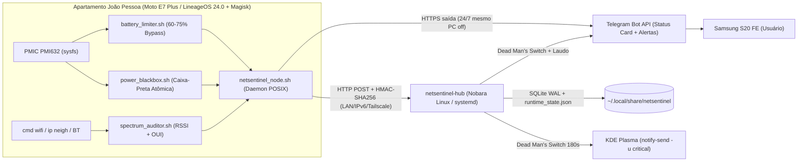
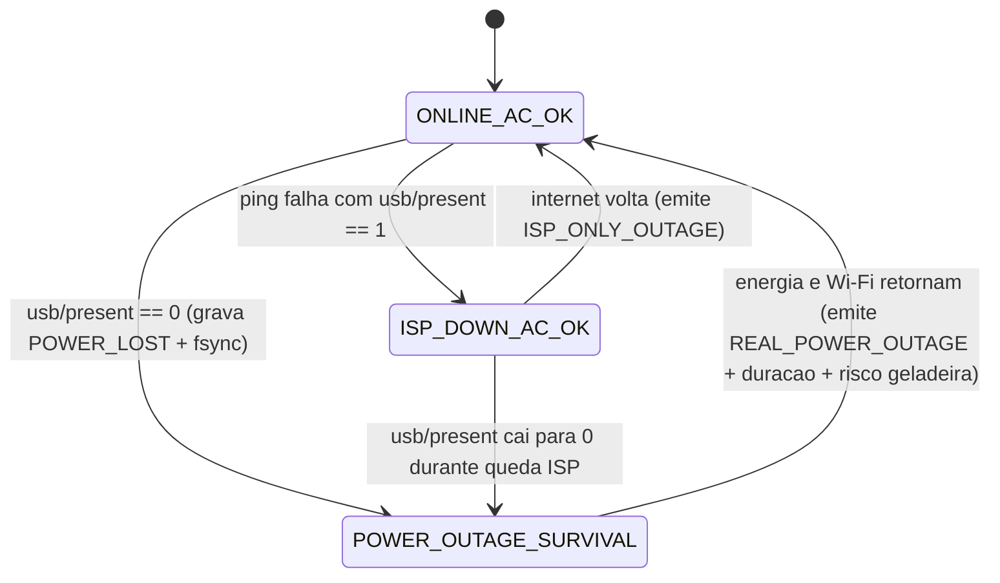

# NetSentinel — Arquitetura Técnica

Sistema distribuído, privado e de custo zero (`R$ 0,00`) para monitoramento de energia elétrica, conectividade e presença passiva por espectro de radiofrequência entre o apartamento remoto em Ponta de Campina (João Pessoa - PB) e a workstation principal em Campina Grande - PB.

---

## 1. Topologia Geral e Duplo Canal Resiliente

Como a workstation em Campina Grande não permanece ligada 24/7 e conexões IPv4 residenciais costumam ficar atrás de NAT/CGNAT, o NetSentinel opera com **redundância ativa em dois canais**:

---

## 2. Máquina de Estados: Queda Elétrica Real vs Queda de Provedor (ISP)

A principal ambiguidade física do cenário (roteador Wi-Fi desliga junto com a energia do apartamento) é resolvida de forma determinística pelo sensor de barramento USB do Qualcomm PMI632 (`/sys/class/power_supply/usb/present`), validado empiricamente como **totalmente desacoplado** do modo bypass de carga (`charging_enabled=0`).

### Garantias Forenses
- **`REAL_POWER_OUTAGE`:** Tomada caiu (`usb/present=0`) junto com o Wi-Fi. Calcula `outage_duration_sec` exato em epoch UTC e ativa alerta alimentar de geladeira/congelador se ultrapassar `FRIDGE_RISK_OUTAGE_SEC` (padrão `14400s` = 4h).
- **`ISP_ONLY_OUTAGE`:** Internet ficou indisponível (`>= 30s`), mas `usb/present` permaneceu `1` durante 100% da janela. Descarta risco de falta de luz no apartamento.
- **Dead Man's Switch (`netsentinel-hub`):** Se o nó parar de enviar heartbeats assinados por `180s` (3 ciclos), dispara alerta imediato no KDE (`notify-send -u critical`) e no Telegram avisando o último nível de bateria e estado da tomada, aguardando a descarga do `blackbox.log` no retorno para o laudo definitivo.

---

## 3. Gerenciador de Saúde da Bateria 24/7 (PMI632 Bypass Real)

Testes reais no Moto E7 Plus comprovaram que `echo 0 > /sys/class/power_supply/battery/charging_enabled` reduz `/sys/class/power_supply/battery/current_now` para exatamente **`0 uA`**, alimentando o sistema direto pela fonte externa sem drenar nem ciclar a bateria.

| Condição | Ação Aplicada no Sysfs | Estado Resultante |
| :--- | :--- | :--- |
| `temp >= 400` (`40.0 °C`) | `charging_enabled=0`, `input_suspend=0` | `THERMAL_CUT` (trava até resfriar para `<= 37.0 °C`) |
| `capacity >= 82%` (em AC) | `charging_enabled=0`, `input_suspend=1` | `GENTLE_DISCHARGE` (desce suavemente à faixa segura) |
| `75% <= capacity < 82%` (em AC) | `charging_enabled=0`, `input_suspend=0` | `BYPASS_HOLD` (`0 uA` na bateria, zero desgaste 24/7) |
| `61% <= capacity <= 74%` (em AC) | `input_suspend=0` (preserva `charging_enabled`) | `HYSTERESIS_KEEP` (evita comutação constante) |
| `capacity <= 60%` (em AC) | `charging_enabled=1`, `input_suspend=0` | `CHARGE_ON` (recarrega até 75%) |
| `ac_present == 0` | `input_suspend=0` (habilita carga se `<= 60%`) | `ON_BATTERY` (entra em Modo Sobrevivência 120s) |

---

## 4. Segurança, Resiliência Atômica e Limites de Recursos

1. **Autenticação HMAC-SHA256 (RFC 2104):**
   - No Android (sem `openssl`), o `lib_common.sh` calcula HMAC-SHA256 em POSIX puro (`sha256sum` + `xxd` + `awk`), validado bit-a-bit contra `hmac.new(..., hashlib.sha256)` do Python.
   - O Hub valida com `hmac.compare_digest` (tempo constante) e exige `|now - timestamp| <= 300s` (anti-replay), limitando payload a 256 KB.
2. **Escrita Atômica (Power-Cut Safe):**
   - No Android: `atomic_write` grava em `<arquivo>.tmp.$$`, chama `fsync`, faz `mv -f` atômico e `fsync` no diretório; `blackbox.log` faz `fsync` a cada evento.
   - No Linux: SQLite em modo `WAL` com `PRAGMA synchronous=FULL`, além de `runtime_state.json` gravado via `os.open(..., 0o600)` + `os.fsync` + `os.replace`.
3. **Orçamento de Recursos:**
   - Nó Android: ~1–2 MB RAM, `oom_score_adj = -1000`, partial wakelock adquirido apenas durante o ciclo ativo (~2–4s) e liberado antes do `sleep` (permite Deep Sleep real durante falta de luz).
   - Hub Linux: Python 3.14 stdlib pura (zero dependências externas de runtime), ~15–20 MB RAM RSS, unit `systemd --user` limitada por `MemoryMax=40M` e `CPUQuota=5%`.
